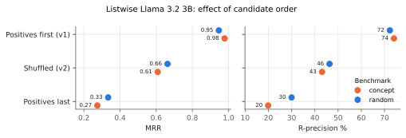

# Does LLM Reranking Help Scientific Paper Recommendation?

**A 13-method benchmark on citation-based relevance, an audit of its first version, and a deployed two-stage recommender for Boğaziçi University researchers**

Sena Öz · Advisor: H. Birkan Yılmaz · Boğaziçi University, M.S. Software Engineering (SWE 599), 2026

[One-page summary](research/audit/SUMMARY.md) · [Statistics](research/v2/stats/) · [v1 → v2 comparison](research/audit/BEFORE_AFTER.md) · [Audit of v1](research/audit/AUDIT.md) · [System setup](README_APP.md) · [Development log](docs/DEVLOG.md) · [Final report (PDF, v1)](SWE599_Final_2026S_OZ_Sena.pdf)

> **Correction (October 2026).** The final report and poster (May 2026) present v1 results, in which Llama 3.2 3B listwise reranking reached MRR 0.84 and beat every embedding method. An audit found the v1 evaluation invalid ([AUDIT.md](research/audit/AUDIT.md)):
> - candidates were always shown positives-first;
> - the prompt's example pointed at a positive;
> - positive candidates carried other papers' text.
>
> The results below are from the rebuilt, leak-free v2 benchmark and supersede v1. The v1 code and results are preserved at tag [`v1-results`](https://github.com/senaoz/SWE-599/tree/v1-results).


*Poster from May 2026; its results are the superseded v1 numbers.*

---

## Summary


Researchers miss relevant work from institutions they don't routinely follow. I built a system that monitors new papers from selected institutions via [OpenAlex](https://openalex.org) and recommends them to Boğaziçi researchers, and I used it to ask a research question:

> **Does reranking embedding-retrieved candidates with a small local LLM improve recommendation quality, and under what conditions?**

**Findings** (v2; 118 test queries; R-precision with 95% bootstrap CIs; Holm-corrected paired Wilcoxon tests; LLM methods averaged over 5 shuffle seeds):

1. **No: embedding models beat every LLM variant.**
   - Qwen3-Embedding-8B is best, with R-precision 87.0% [84.2, 89.7] on random negatives and 80.1% [77.0, 83.0] on topically matched negatives.
   - Listwise Llama 3.2 3B scores 43.9% and 42.0%, close to chance (33.3%) and about 40 points below Qwen3 (p ≈ 2·10⁻¹⁹).
2. **The earlier "LLM advantage" was position bias.**
   - With only the candidate order changed, the same model on the same queries gets MRR 0.95–0.98 when positives come first (v1's order) and 0.27–0.33 when they come last, below chance (≈ 0.56).
   - Most of the time it returns the candidates in the order it was given them.
3. **Reranking hurts the two-stage pipeline, and stage 1 is not the reason.**
   - Qwen3's top 10 already holds about 90% of the true references.
   - Reranking them with Llama scores 13.0 / 10.4 points below Qwen3 alone (p ≤ 3·10⁻¹⁰).
4. **Small embedding models are almost as good as large ones.**
   - MiniLM (22M parameters) is within 3.7 / 4.4 points of Qwen3-8B.
   - SPECTER2 and MiniLM are indistinguishable (p ≥ 0.94).
   - Among LLM variants, only pointwise scoring (78.8 / 73.9) beats the lexical baselines.




---

## Benchmark (v2)

| | |
|---|---|
| **Task** | Given a query paper, rank candidate papers so that the papers it actually cites appear first |
| **Queries** | The 174 v1 query papers, from OpenAlex (post-2020 papers from MIT, Stanford, Harvard, UC Berkeley, U. Michigan, Google, Google DeepMind) citing 6–14 works. 168 are usable; 50 form a **dev** split used only for tuning and **118** form the **test** split. |
| **Positives** | The query's cited references, fetched from OpenAlex by id. Every candidate needs a title and an abstract. 3–14 positives per query. |
| **Negatives** | 2*n* per query, drawn from other queries' references published **before** the query and sharing no author with it. **`random`:** sampled uniformly. **`concept`:** must share one of the query's top-5 OpenAlex concepts (harder). |
| **Candidate order** | Shuffled per query and seed. The order shown to each model is stored. |
| **Input** | The same text for every method: title + abstract + concepts, 600 characters per candidate and 1,500 for the query (chosen on dev). |
| **Metrics** | **R-precision**: share of the top *n* that are true references, where *n* is the number of positives. This is the primary metric, because MRR saturates near 1.0 for the strong methods. Also reported: MRR, nDCG@*n*, average precision. |
| **Models** | All local. Llama 3.2 3B Instruct (Q4_K_M) and Qwen3-Embedding-8B (Q4_K_M) are served by llama.cpp; MiniLM, SPECTER2, EmbeddingGemma and bge-reranker-base run via sentence-transformers. |

Construction and runs: numbered notebooks in [`research/v2/`](research/v2/) (01 fetch → 02 build → 03 dev tuning → 04 test runs → 05 statistics → 06 analyses). Per-query runs: [`research/v2/runs/`](research/v2/runs/).

## Results (v2, test split)

R-precision % [95% CI] and MRR. The chance level (a random ranking) is 33.3% R-precision and 0.559 MRR.

| Method | R-prec, `random` | R-prec, `concept` | MRR, `random` | MRR, `concept` |
|---|---|---|---|---|
| Qwen3-Embedding-8B | **87.0** [84.2, 89.7] | **80.1** [77.0, 83.0] | 0.987 | 0.970 |
| EmbeddingGemma | 85.6 [82.7, 88.4] | 78.5 [75.4, 81.4] | 1.000 | 0.983 |
| Qwen3 + MiniLM (fusion) | 85.6 [82.6, 88.5] | 78.2 [74.8, 81.3] | 0.986 | 0.957 |
| SPECTER2 | 83.5 [80.5, 86.4] | 76.6 [73.3, 79.9] | 0.976 | 0.947 |
| MiniLM (all-MiniLM-L6-v2) | 83.3 [80.2, 86.3] | 75.7 [72.1, 79.2] | 0.985 | 0.957 |
| Llama 3.2 3B, pointwise | 78.8 [75.6, 81.9] | 73.9 [70.5, 77.3] | 0.947 | 0.928 |
| TF-IDF | 75.3 [72.3, 78.3] | 65.4 [61.8, 69.0] | 0.921 | 0.880 |
| Two-stage: Qwen3 → listwise Llama, k = 10 | 74.0 [71.4, 76.6] | 69.7 [67.0, 72.3] | 0.879 | 0.855 |
| Llama + MiniLM (fusion) | 69.0 [66.9, 71.1] | 63.7 [61.3, 66.2] | 0.966 | 0.935 |
| BM25 | 68.6 [65.5, 71.5] | 63.4 [60.0, 66.7] | 0.904 | 0.856 |
| bge-reranker-base (cross-encoder) | 67.2 [63.3, 71.0] | 58.1 [54.4, 61.8] | 0.912 | 0.872 |
| Llama 3.2 3B, listwise, sliding window | 55.6 [53.5, 57.8] | 52.2 [49.9, 54.5] | 0.797 | 0.777 |
| Llama 3.2 3B, listwise, full list | 43.9 [41.9, 46.0] | 42.0 [40.2, 43.9] | 0.662 | 0.638 |

Significance tests and seed spread: [`research/v2/stats/`](research/v2/stats/). All figures (PDF and SVG): [`research/v2/figures/`](research/v2/figures/).

**Position bias** (listwise Llama, same 118 test queries and candidates, only the order changed; `random` / `concept`):

| Candidate order | MRR [95% CI] | R-precision % |
|---|---|---|
| Positives first (v1's order) | 0.95 [0.91, 0.98] / 0.98 [0.95, 1.00] | 72 / 74 |
| Shuffled | 0.66 [0.61, 0.72] / 0.61 [0.55, 0.66] | 46 / 43 |
| Positives last | 0.33 [0.27, 0.40] / 0.27 [0.21, 0.34] | 30 / 20 |

Only the order changes in this experiment; prompt and candidate text are v2's. So order alone reproduces v1's MRR 0.84.

The order dependence also shows directly in the outputs. Across 1,177 shuffled test rankings, the Spearman correlation between the output order and the input order has median **0.98**:
- **50.6%** of outputs copy the input list (ρ > 0.8);
- **6.7%** reverse it (ρ < −0.8);
- only 29.5% look order-independent (|ρ| ≤ 0.3).

> *Example (test query* Challenges to the Reproducibility of Machine Learning Models in Health Care*, 12 candidates, 4 cited).* Llama returns the list reversed regardless of content:
> - with the 4 cited papers shown first, it outputs `["12","9","8",…,"1",…]` (R-precision 0);
> - with them shown last, it outputs `["12","10","11","9",…,"1"]` (R-precision 100).
>
> Qwen3 ranks the cited papers 1st, 2nd, 4th and 5th in every order.

**Other findings**
- **Stage-1 recall.** Qwen3's top 10 holds 93% / 89% of the cited references, and its top 20 holds 99% / 98%. BM25 holds 81% / 76% at k = 10. A BM25 + Qwen3 hybrid (reciprocal rank fusion) holds 89% / 84%, and its R-precision (78.7 / 72.8) is below Qwen3 alone.
- **Listwise output reliability.** Full-list Llama returns a partial ranking in 38% of calls. The sliding window (at most 10 candidates per call) brings this down to about 2% of queries.
- **Candidate text.** On dev, adding abstracts helps lexical methods most (TF-IDF +16 points on `random`). Qwen3 is insensitive to the input fields, while bge-reranker and listwise Llama get worse with longer text.
- **Seeds.** Across 5 shuffle seeds, the standard deviation of each LLM method's R-precision is 0.8–2.0 points. Full-list Llama's best seed (46.3 on `random`, 43.3 on `concept`) is still below every other method's mean.

## Limitations

- **Citation is a proxy for relevance.** Researchers may find uncited papers relevant and cited ones irrelevant. There are no human relevance judgments yet.
- **Negatives are not same-topic hard negatives.** The `concept` match often rests on a broad field label such as "Medicine". Full-corpus retrieval with hard negatives is the next experiment.
- **One small LLM.** Results are for Llama 3.2 3B (Q4_K_M). Larger or retrieval-tuned LLMs may behave differently.
- **Pretraining contamination is untested.** Only one test query was published after Llama 3.2's December 2023 knowledge cutoff.
- **Simplified embedding inputs.** Qwen3-Embedding and EmbeddingGemma run without their recommended instruction prefixes, and bge-reranker-base truncates query-candidate pairs at 512 tokens.
- **Data quality** ([DATA_QUALITY.md](research/audit/DATA_QUALITY.md)).
  - 155 listed references no longer exist in OpenAlex.
  - 1.4% of positives are duplicate OpenAlex records of the same paper.
  - About 6% of papers have an "abstract" that is not one: author lists, citation strings, or another paper's title. Dropping the affected test queries changes no method by more than about 1 point.
- **Not a paired re-run of v1.** v1's candidate pools cannot be regenerated, so v1 and v2 numbers are compared claim by claim, not query by query ([BEFORE_AFTER.md](research/audit/BEFORE_AFTER.md)).

## Next steps

Planned in [`research/audit/TODO.md`](research/audit/TODO.md), with the motivation in [`IMPROVEMENT_IDEAS.md`](research/audit/IMPROVEMENT_IDEAS.md):

1. **Better relevance labels.**
   - Graded labels from citation intent and influence instead of "cited = relevant".
   - Same-topic hard negatives.
   - Pooled human judgments for 20–30 queries, to measure how well the citation proxy agrees with researchers.
2. **Full-corpus retrieval with leakage-controlled citation-graph expansion.**
   - Rank a full corpus (about 10k papers) instead of fixed pools.
   - Expand the first-stage list with co-citation neighbours, under explicit leakage rules: no query reference lists, no test-query citers, only earlier citers, deduplicated records.
   - Controls: a leakage canary and a random-graph baseline.
3. **Human-centered evaluation.** The deployed system already records thumbs-up/down feedback on each paper–researcher match. The questions:
   - does offline ranking quality predict what researchers find useful?
   - how do researchers judge and trust LLM-produced recommendations compared with similarity scores?

---

## The system

A fully containerized recommender that runs the two-stage pipeline every six hours:

1. **Fetch** new papers from followed institutions (OpenAlex API, cursor-based incremental fetching).
2. **Stage 1, Retrieve:** Qwen3 embeddings (`qwen3-embedding`, 4096-d, stored in PostgreSQL with pgvector); cosine similarity against ~7,800 Boğaziçi paper embeddings; top-10 researchers above a 0.3 threshold.
3. **Stage 2, Rerank:** Llama 3.2 3B (Ollama) decides `RELEVANT <score>` / `IRRELEVANT <score>` for each candidate researcher. Falls back to Stage-1 scores if the LLM is unavailable. *The v2 benchmark finds that listwise LLM reranking lowers Qwen3's own ranking. This pointwise stage has not been benchmarked yet and is under review; see [`APP_NOTES.md`](APP_NOTES.md).*
4. **Serve** a React 19 + TypeScript interface: paper feed, researcher pages, institution following, relevance feedback, admin panel.

Stack: FastAPI · SQLAlchemy (async) · PostgreSQL 16 + pgvector · Ollama · React 19 · Vite · Tailwind · Docker Compose. Setup instructions: [`README_APP.md`](README_APP.md).

## Reproduce the analysis

Statistics from the committed per-query runs (no models needed):

```bash
git clone https://github.com/senaoz/SWE-599.git && cd SWE-599/research
python3 -m venv .venv && .venv/bin/pip install -r requirements.txt
.venv/bin/python -m ipykernel install --user --name swe599-research
.venv/bin/papermill v2/05_stats.ipynb v2/05_stats.ipynb --cwd v2
.venv/bin/papermill v2/06_analysis.ipynb v2/06_analysis.ipynb --cwd v2
```

To re-run the methods themselves, serve the two GGUF models with llama.cpp's `llama-server` (OpenAI-compatible API on `127.0.0.1:1337`) and run notebooks 01–04. See [`research/README.md`](research/README.md). The v1 audit is reproduced by `python research/audit/verify_v1.py`.

## Repository structure

```
research/                      see research/README.md
  src/                         shared code: v2 pipeline, rankers, stats, figures; v1 similarity/metrics
  v1/                          numbered notebooks · results/ (per-query rankings) · stats/
  audit/                       v1 audit (AUDIT.md, verify_v1.py) · BEFORE_AFTER.md · DATA_QUALITY.md · SUMMARY.md · TODO.md · IMPROVEMENT_IDEAS.md
  v2/                          leak-free benchmark: notebooks 01–06 · eval_sets/ · runs/ · stats/ · figures/
backend/                       FastAPI service, scheduler, matching pipeline
frontend/                      React application
docs/DEVLOG.md                 development log, incl. the dated v2 audit log
APP_NOTES.md                   follow-ups for the deployed app
SWE599_Final_2026S_OZ_Sena.pdf final report
```
