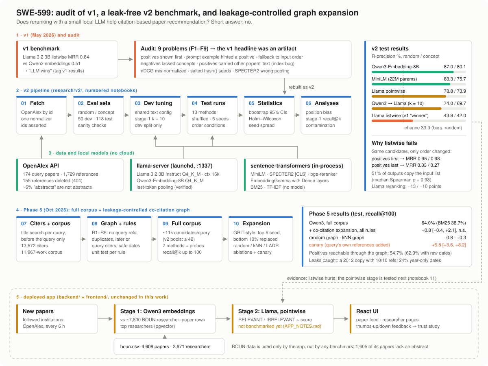
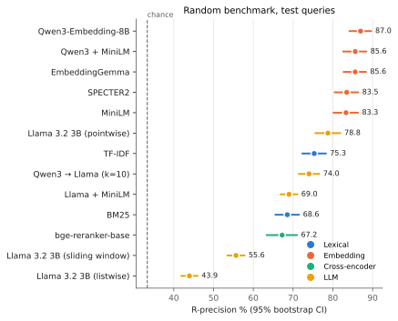
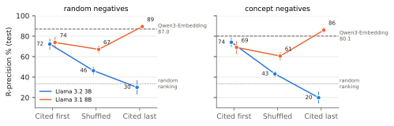
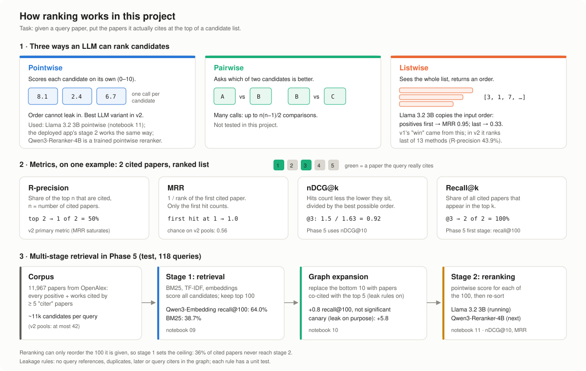
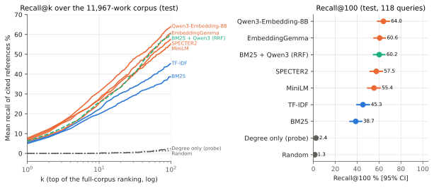
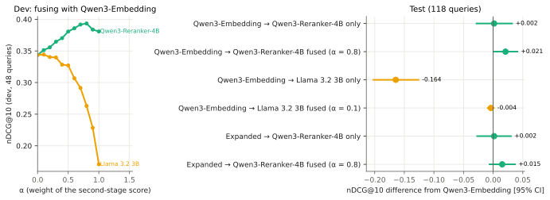
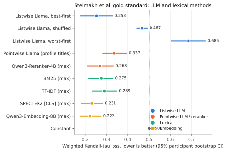
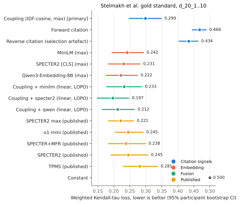

# Does LLM Reranking Help Scientific Paper Recommendation?

**A 13-method benchmark on citation-based relevance, an audit of its first version, a check against human expertise labels, and a deployed two-stage recommender for Boğaziçi University researchers**

Sena Öz · Advisor: H. Birkan Yılmaz · Boğaziçi University, M.S. Software Engineering (SWE 599), 2026

[Paper draft (PDF)](paper/main.pdf) · [One-page summary](research/audit/SUMMARY.md) · [Statistics](research/v2/stats/) · [v1 → v2 comparison](research/audit/BEFORE_AFTER.md) · [Audit of v1](research/audit/AUDIT.md) · [System setup](README_APP.md) · [Development log](docs/DEVLOG.md) · [Final report (PDF, v1)](SWE599_Final_2026S_OZ_Sena.pdf)

Researchers miss relevant work from institutions they don't routinely follow. This project has two parts:

- **An app** that fetches new papers from followed institutions (MIT, Stanford, Harvard, UC Berkeley, U. Michigan, Google, Google DeepMind) via [OpenAlex](https://openalex.org) and lists, under each paper, the Boğaziçi researchers who work on its topic. It ranks researchers with embeddings (stage 1) and then reranks them with a small local LLM (stage 2).
- **A research question** behind stage 2:

> **Does reranking embedding-retrieved candidates with a small local LLM improve recommendation quality, and under what conditions?**

**Short answer: no.** On citation labels, on a 12k-paper corpus and on human expertise labels, a good embedding model (Qwen3-Embedding-8B) alone is best. A small general LLM (Llama 3.2 3B) used as a reranker lowers the ranking, and its listwise variant mostly copies the order it is shown.

> **Correction (October 2026).** The final report (May 2026) presents v1 results, in which Llama 3.2 3B listwise reranking reached MRR 0.84 and beat every embedding method. An audit found the v1 evaluation invalid ([AUDIT.md](research/audit/AUDIT.md)): candidates were always shown positives-first, the prompt's example pointed at a positive, and positive candidates carried other papers' text. Everything below comes from the rebuilt, leak-free v2 benchmark and later phases, and supersedes v1. The v1 code and results are preserved at tag [`v1-results`](https://github.com/senaoz/SWE-599/tree/v1-results).

## Status (October 2026)

| Part | State |
|---|---|
| Research | Done through notebook 18 (`research/v2/`). Paper draft in [`paper/`](paper/) ([PDF](paper/main.pdf)), not yet on arXiv; written as an audit and re-evaluation with position bias as the headline. |
| Deployed app | **Unchanged since v1:** still Qwen3-Embedding → Llama 3.2 3B, seeded from the old `boun.csv`. The research says stage 2 should go; [APP_NOTES.md](APP_NOTES.md) collects what the app needs. |
| App redesign | Draft in [docs/MATCHING_DESIGN.md](docs/MATCHING_DESIGN.md): no LLM stage 2, a per-work Boğaziçi index on the cleaned data, versioned matches and feedback. Decisions D1–D10 open; no code yet. |
| Branch `app-mtplx-stage2` | Stage 2 on a 27B model via MTPLX. **On hold, not to be merged as is:** the feed's cosine filter (0.3) would hide every LLM-scored match. |

## The project at a glance

| Phase | Question | Answer in one line | Notebooks · details |
|---|---|---|---|
| **v1** (May 2026) | Does LLM reranking beat embeddings? | Seemed so (MRR 0.84 vs 0.51) | `research/v1/` · [final report](SWE599_Final_2026S_OZ_Sena.pdf) |
| **Audit** | Is the v1 evaluation valid? | No: nine problems (F1–F9), headline was an artifact | [AUDIT.md](research/audit/AUDIT.md) · `verify_v1.py` |
| **v2 benchmark** | Same question, leak-free, 13 methods | Embeddings win; listwise Llama ≈ chance | `01`–`06` · [BEFORE_AFTER.md](research/audit/BEFORE_AFTER.md) |
| **Phase 5** | Does it hold on a full 12k-paper corpus, with co-citation expansion and reranking? | Yes; co-citation adds nothing significant; only a trained reranker (fused) helps a little | `07`–`12` · [PHASE5_DESIGN.md](research/audit/PHASE5_DESIGN.md) |
| **Boğaziçi data** | Is the app's researcher data sound? | Partly: rebuilt as 7,822 cleaned works | `13` · [BOUN_DATA.md](research/audit/BOUN_DATA.md) |
| **Gold standard** | Do the conclusions hold on human expertise labels? Does bibliographic coupling help? | Yes, same winner; coupling is real but adds nothing to Qwen3 | `14`–`18` · [GOLDSTANDARD_DATA.md](research/audit/GOLDSTANDARD_DATA.md) |



*The overview diagram covers every part of the project; each part has its own section below.*

## Main findings

1. **Embedding models beat every LLM variant.** On v2, Qwen3-Embedding-8B reaches R-precision 87.0% [84.2, 89.7] on random negatives and 80.1% [77.0, 83.0] on topically matched ones. Listwise Llama 3.2 3B scores 43.9% and 42.0%, close to chance (33.3%) and about 40 points below Qwen3 (p ≈ 2·10⁻¹⁹).
2. **The earlier "LLM advantage" was position bias.** With only the candidate order changed, the same model gets MRR 0.95–0.98 when positives come first (v1's order) and 0.27–0.33 when they come last, below chance (≈ 0.56). Most of the time it returns the candidates in the order it was given them. A larger model does not remove the effect but reverses it: Llama 3.1 8B favours the *last* candidates, with R-precision 73.9 / 69.0 when the cited papers come first and 89.4 / 85.9 when they come last, above Qwen3-Embedding (one shuffle seed). The same reversal holds on human labels: the 8B model's loss is 0.413 with the best papers first and 0.253 with them last (Holm p = 7.7·10⁻⁵).
3. **Reranking hurts the two-stage pipeline, and stage 1 is not the reason.** Qwen3's top 10 already holds about 90% of the true references; reranking them with Llama scores 13.0 / 10.4 points below Qwen3 alone (p ≤ 3·10⁻¹⁰).
4. **Small embedding models are almost as good as large ones.** MiniLM (22M parameters) is within 3.7 / 4.3 points of Qwen3-8B.
5. **The full corpus is much harder, and extra signals add little.** Against 11,967 papers, Qwen3's R-precision falls to 25.1%. Leakage-controlled co-citation expansion adds nothing significant; pointwise Llama halves nDCG@10; only Qwen3-Reranker-4B, fused with the embedding, helps modestly.
6. **Human labels agree.** On the Stelmakh et al. expertise ratings, Qwen3-Embedding again has the lowest loss, every LLM method is significantly worse, and the position bias replicates (best-first 0.253, shuffled 0.467, worst-first 0.685).





---

## Ranking in a nutshell

The diagram below introduces the terms used in the rest of this README:
- **Ranking approaches.** An LLM can score candidates *pointwise* (one at a time), *pairwise* (two at a time) or *listwise* (the whole list at once). Listwise ranking is where Llama 3.2 3B copied the input order.
- **Metrics.** R-precision, MRR, nDCG@k and recall@k, each worked out on one small example.
- **Phase 5 pipeline.** Full-corpus retrieval, then leakage-controlled co-citation expansion, then pointwise reranking (notebooks 09–12 in `research/v2/`).



---

## Benchmark (v2)

| | |
|---|---|
| **Task** | Given a query paper, rank candidate papers so that the papers it actually cites appear first |
| **Queries** | The 174 v1 query papers, from OpenAlex (post-2020 papers from MIT, Stanford, Harvard, UC Berkeley, U. Michigan, Google, Google DeepMind) citing 6–14 works. 168 are usable; 50 form a **dev** split used only for tuning and **118** form the **test** split. |
| **Positives** | The query's cited references, fetched from OpenAlex by id. Every candidate needs a title and an abstract. 3–14 positives per query. |
| **Negatives** | 2*n* per query, drawn from other queries' references published **before** the query and sharing no author with it. **`random`:** sampled uniformly. **`concept`:** must share one of the query's top-5 OpenAlex concepts (harder). |
| **Candidate order** | Shuffled per query and seed. The order shown to each model is stored. |
| **Input** | The same text for every method: title + abstract + concepts, 600 characters per candidate and 1,500 for the query (chosen on dev). |
| **Metrics** | **R-precision**: share of the top *n* that are true references, where *n* is the number of positives. This is the primary metric, because MRR saturates near 1.0 for the strong methods. Also reported: MRR, nDCG@*n*, average precision. |
| **Models** | All local. Llama 3.2 3B Instruct (Q4_K_M) and Qwen3-Embedding-8B (Q4_K_M) are served by llama.cpp; MiniLM, SPECTER2, EmbeddingGemma and bge-reranker-base run via sentence-transformers. |

### How `random` and `concept` differ

The two benchmarks share everything except the negatives. Each query has the same positives, the same number of negatives (2*n*) and the same candidate pool: other queries' references, published before the query and with no shared author. Only the way negatives are drawn from that pool changes:

- **`random`** samples negatives uniformly from the pool. Most of them come from unrelated topics, so a method only has to tell "this field" from "another field".
- **`concept`** keeps only pool papers that share at least one of the query's top-5 OpenAlex concepts, then samples from those. For 7 of 168 queries too few papers match, and the remaining slots are filled with random negatives.

Share of candidates that share at least one top-5 concept with their query (all 168 queries):

| | Positives | `random` negatives | `concept` negatives |
|---|---|---|---|
| Share a top-5 concept | 73.5% | 29.5% | 97.7% |
| …of those, only through a top-level field (e.g. "Medicine", "Computer science") | 33.2% | 79.1% | 68.7% |

So `concept` negatives look like positives on the concept tags; in fact they match more often than the positives do. Most of them match only through a broad field label, though, so `concept` means **same field, not same topic**. It is a harder setting, not a true hard-negative benchmark. Every method scores lower on `concept`, by 1.9 (listwise Llama, already near chance) to 9.9 (TF-IDF) R-precision points.

<details>
<summary>Two worked examples</summary>

**Example 1** (test query, 2021): *LocusZoom.js: interactive and embeddable visualization of genetic association study results*. Top-5 concepts: Computer science, MIT License, Annotation, JavaScript, Visualization.

| Role | Paper (year) | Shared top-5 concepts |
|---|---|---|
| Positive | LocusZoom: regional visualization of genome-wide association scan results (2010) | Computer science |
| Positive | Tabix: fast retrieval of sequence features from generic TAB-delimited files (2011) | Computer science |
| Positive | The NHGRI-EBI GWAS Catalog of published genome-wide association studies… (2018) | — |
| `random` negative | Multipoint high-fidelity CFD-based aerodynamic shape optimization of a 10 MW wind turbine (2019) | — |
| `random` negative | Epidemiology of COVID-19 Among Children in China (2020) | — |
| `random` negative | A Practical Guide to Selection Bias in Instrumental Variable Analyses (2019) | — |
| `concept` negative | What is Twitter, a social network or a news media? (2010) | Computer science |
| `concept` negative | Roofline (2009) | Computer science |
| `concept` negative | Bootstrap confidence intervals: when, which, what? A practical guide for medical statisticians (2000) | Computer science |

All six `concept` negatives of this query match only through "Computer science"; none is about genetics or visualization. Three of six negatives are shown per benchmark.

**Example 2** (test query, 2020): *Challenges to the Reproducibility of Machine Learning Models in Health Care*. Top-5 concepts: Medicine, Reproducibility, Machine learning, Health care, Artificial intelligence.

| Role | Paper (year) | Shared top-5 concepts |
|---|---|---|
| Positive | Estimating the reproducibility of psychological science (2015) | Reproducibility |
| Positive | Why Most Published Research Findings Are False (2005) | Medicine |
| `random` negative | Within host RNA virus persistence: mechanisms and consequences (2017) | — |
| `random` negative | Dissecting racial bias in an algorithm used to manage the health of populations (2019) | Health care |
| `concept` negative | Interpretable Decision Sets (2016) | Machine learning, Artificial intelligence |
| `concept` negative | Enfortumab Vedotin Antibody–Drug Conjugate Targeting Nectin-4… (2016) | Medicine |
| `concept` negative | Optimizing CAR-T Cell Manufacturing Processes during Pivotal Clinical Trials (2019) | Medicine |

Shown: 2 of 4 positives, 2 of 8 `random` and 3 of 8 `concept` negatives. Here 7 of the 8 `concept` negatives match only through "Medicine" or "Health care". Some `random` negatives (the racial-bias paper) are arguably as close to the query as any `concept` negative.

</details>

Construction and runs: numbered notebooks in [`research/v2/`](research/v2/) (01 fetch → 02 build → 03 dev tuning → 04 test runs → 05 statistics → 06 analyses). Per-query runs: [`research/v2/runs/`](research/v2/runs/).

## Results (v2, test split)

R-precision % [95% CI] and MRR. The chance level (a random ranking) is 33.3% R-precision and 0.559 MRR. LLM methods are averaged over 5 shuffle seeds; significance is Holm-corrected paired Wilcoxon.

| Method | R-prec, `random` | R-prec, `concept` | MRR, `random` | MRR, `concept` |
|---|---|---|---|---|
| Qwen3-Embedding-8B | **87.0** [84.2, 89.7] | **80.1** [77.0, 83.0] | 0.987 | 0.970 |
| EmbeddingGemma | 85.6 [82.7, 88.4] | 78.5 [75.4, 81.4] | 1.000 | 0.983 |
| Qwen3 + MiniLM (fusion) | 85.6 [82.6, 88.5] | 78.2 [74.8, 81.3] | 0.986 | 0.957 |
| SPECTER2 | 83.5 [80.5, 86.4] | 76.6 [73.3, 79.9] | 0.976 | 0.947 |
| MiniLM (all-MiniLM-L6-v2) | 83.3 [80.2, 86.3] | 75.7 [72.1, 79.2] | 0.985 | 0.957 |
| Llama 3.2 3B, pointwise | 78.8 [75.6, 81.9] | 73.9 [70.5, 77.3] | 0.947 | 0.928 |
| TF-IDF | 75.3 [72.3, 78.3] | 65.4 [61.8, 69.0] | 0.921 | 0.880 |
| Two-stage: Qwen3 → listwise Llama, k = 10 | 74.0 [71.4, 76.6] | 69.7 [67.0, 72.3] | 0.879 | 0.855 |
| Llama + MiniLM (fusion) | 69.0 [66.9, 71.1] | 63.7 [61.3, 66.2] | 0.966 | 0.935 |
| BM25 | 68.6 [65.5, 71.5] | 63.4 [60.0, 66.7] | 0.904 | 0.856 |
| bge-reranker-base (cross-encoder) | 67.2 [63.3, 71.0] | 58.1 [54.4, 61.8] | 0.912 | 0.872 |
| Llama 3.2 3B, listwise, sliding window | 55.6 [53.5, 57.8] | 52.2 [49.9, 54.5] | 0.797 | 0.777 |
| Llama 3.2 3B, listwise, full list | 43.9 [41.9, 46.0] | 42.0 [40.2, 43.9] | 0.662 | 0.638 |

SPECTER2 and MiniLM are indistinguishable (Holm p ≥ 0.84). Among LLM variants, only pointwise scoring beats the lexical baselines. Significance tests: [`research/v2/stats/`](research/v2/stats/); seed spread: [`05_stats.ipynb`](research/v2/05_stats.ipynb). All figures (PDF and SVG): [`research/v2/figures/`](research/v2/figures/).

**Position bias** (listwise Llama, same 118 test queries and candidates, only the order changed; `random` / `concept`):

| Candidate order | MRR [95% CI] | R-precision % |
|---|---|---|
| Positives first (v1's order) | 0.95 [0.91, 0.98] / 0.98 [0.95, 1.00] | 72 / 74 |
| Shuffled | 0.66 [0.61, 0.72] / 0.61 [0.55, 0.66] | 46 / 43 |
| Positives last | 0.33 [0.27, 0.40] / 0.27 [0.21, 0.34] | 30 / 20 |

Only the order changes in this experiment; prompt and candidate text are v2's. So order alone reproduces v1's MRR 0.84.

<details>
<summary>How the model copies the input order, and other v2 findings</summary>

Across 1,177 shuffled test rankings, the Spearman correlation between the output order and the input order has median **0.98**:
- **50.6%** of outputs copy the input list (ρ > 0.8);
- **6.7%** reverse it (ρ < −0.8);
- only 29.5% look order-independent (|ρ| ≤ 0.3).

> *Example (test query* Challenges to the Reproducibility of Machine Learning Models in Health Care*, 12 candidates, 4 cited).* Llama returns the list reversed regardless of content:
> - with the 4 cited papers shown first, it outputs `["12","9","8",…,"1",…]` (R-precision 0);
> - with them shown last, it outputs `["12","10","11","9",…,"1"]` (R-precision 100).
>
> Qwen3 ranks the cited papers 1st, 2nd, 4th and 5th in every order.

- **Stage-1 recall.** Qwen3's top 10 holds 93% / 89% of the cited references, and its top 20 holds 99% / 98%. BM25 holds 81% / 76% at k = 10. A BM25 + Qwen3 hybrid (reciprocal rank fusion) holds 89% / 84%, and its R-precision (78.7 / 72.8) is below Qwen3 alone.
- **Listwise output reliability.** Full-list Llama returns a partial ranking in 38% of calls. The sliding window (at most 10 candidates per call) brings this down to about 2% of queries.
- **Candidate text.** On dev, adding abstracts helps lexical methods most (TF-IDF +16 points on `random`). Qwen3 is insensitive to the input fields, while bge-reranker and listwise Llama get worse with longer text.
- **Seeds.** Across 5 shuffle seeds, the standard deviation of each LLM method's R-precision is 0.8–2.0 points. Full-list Llama's best seed (46.3 on `random`, 43.3 on `concept`) is still below every other method's mean.

</details>

## Phase 5: full corpus, graph expansion and reranking (test split)

v2 ranks each query against a fixed pool of at most 42 candidates. Phase 5 makes the task realistic: each query is ranked against **11,967 papers**, about 11k of them candidates per query. Notebooks `07`–`12` in [`research/v2/`](research/v2/); design and decisions in [PHASE5_DESIGN.md](research/audit/PHASE5_DESIGN.md).

- **Corpus.** For each query, an OpenAlex title search found papers published before it ("citers"). The corpus is every eligible positive plus every work cited by at least 5 citers. Duplicate records are merged in the corpus, the labels and the graph.
- **Co-citation graph under leakage rules.** The query's own references, copies or earlier versions of a query, citers dated on or after the query (with a conservative date, because 24% of citers carry year-only Jan 1 dates) and other query papers never enter a query's graph. Each rule has a unit test. The checks found real leaks, for example a 2012 record of a Cochrane review that held all 10 references of a 2020 query.

| Recall@100 (118 test queries) | % [95% CI] |
|---|---|
| Qwen3-Embedding-8B | **64.0** [58.7, 69.4] |
| EmbeddingGemma · SPECTER2 · MiniLM | 60.6 · 57.5 · 55.4 |
| TF-IDF · BM25 | 45.3 · 38.7 |
| Degree-only probe · random | 2.4 · 1.3 |

| Change to Qwen3-Embedding's top 100 | Effect on test |
|---|---|
| Co-citation expansion (bottom 10% replaced, all leakage rules) | recall@100 +0.8 [−0.4, +2.1], not significant |
| Same expansion on degree-preserving random graphs | −0.5 to −0.9 |
| Leakage canary (query's own references added on purpose) | +5.8 [+3.6, +8.2] |
| Rerank with pointwise Llama 3.2 3B, alone | nDCG@10 0.340 → 0.175 (Holm p = 3.1·10⁻¹¹) |
| Rerank with Llama 3.2 3B, fused with the embedding score | −0.004, not significant |
| Rerank with Qwen3-Reranker-4B, fused (weight chosen on dev) | nDCG@10 0.340 → 0.360 (+0.021 [+0.001, +0.041], Holm p = 0.22); R-precision 25.1 → 28.3 (Holm p = 0.040) |

**What this shows**
1. **The full corpus is much harder.** Qwen3-Embedding's R-precision falls from 87.0% on the v2 pools to 25.1%, and over a third of cited papers fall outside the top 100.
2. **Leakage-controlled co-citation expansion adds nothing significant on top of a strong dense first stage.** Only 54.7% of test positives are reachable through an allowed citer at all; the canary shows the method works when the signal is present; relaxing the rules would have inflated reachability to 62.9–70.1%.
3. **A small general LLM does not help as a reranker, even pointwise.** A model trained for reranking does, modestly, when fused with the embedding score. That reranker was released in 2025 and may have seen these papers in pretraining.





## Boğaziçi researcher data

The app matches papers to Boğaziçi researchers through their own papers. Its seed file (`research/data/cleaned/boun.csv`, 4,608 papers) turned out to keep errata and editorials, miss conference papers and preprints, and cut author lists at 100. The data were refetched from OpenAlex (all research types since 2020) and cleaned: **7,822 works, 3,648 Boğaziçi researchers, text for 84.2% of works**, duplicates merged, misattributed authors on large physics collaborations removed. They live in [`research/data/boun/`](research/data/boun/) (Git LFS); data card: [BOUN_DATA.md](research/audit/BOUN_DATA.md); exploration: notebook `13`. The app does not use them yet.

## Human-labelled expertise: Stelmakh et al. gold standard

Citation labels measure "would cite", not expertise. To check the conclusions against human labels, the same scoring function the app uses (a paper against a researcher's own papers, max over those papers) is evaluated on the public gold standard of Stelmakh et al. (TMLR 2025): 58 researchers rated their expertise (1–5) on 477 papers they had read. Each researcher is a profile of up to 20 of their own papers (10 random samples). The metric is the authors' weighted Kendall-tau loss (lower is better, constant = 0.5) with a participant bootstrap; our port of it reproduces all 11 published baselines, which agree with the paper's Table 3. Data card: [GOLDSTANDARD_DATA.md](research/audit/GOLDSTANDARD_DATA.md); notebooks `14`–`18` in [`research/v2/`](research/v2/), outputs in [`research/v2/goldstandard/`](research/v2/goldstandard/).

It also tests **bibliographic coupling** (a new paper and a researcher's paper cite the same works), a signal available the moment a paper is published. The method was pre-registered before any score was computed: IDF-weighted cosine over OpenAlex reference lists (80.3% of profile papers have one, against 33.0% in Semantic Scholar), max over profile papers; fusion weights chosen by leave-one-participant-out.

| Loss (d_20_1..10) [95% CI] | | vs Qwen3-Embedding |
|---|---|---|
| Qwen3-Embedding-8B, max | **0.222** [0.177, 0.274] | |
| SPECTER2 [CLS], max (published: 0.221) | 0.231 [0.183, 0.282] | |
| MiniLM, max | 0.242 [0.194, 0.292] | |
| o1-mini (published) | 0.245 | |
| Qwen3-Reranker-4B + Qwen3-Embedding, fused (post-hoc) | 0.233 [0.187, 0.289] | no gain |
| Qwen3-Reranker-4B, max | 0.268 [0.210, 0.333] | worse, Holm p = 9.4·10⁻³ |
| BM25, max | 0.275 [0.216, 0.331] | worse, Holm p = 1.0·10⁻² |
| TF-IDF, max | 0.289 [0.233, 0.349] | worse, Holm p = 2.4·10⁻³ |
| Coupling, IDF-cosine, max (pre-registered) | 0.299 [0.248, 0.348] | not significant |
| Pointwise Llama 3.2 3B | 0.337 [0.282, 0.395] | worse, Holm p = 3.9·10⁻⁴ |
| Listwise Llama 3.2 3B, shuffled | 0.467 [0.442, 0.493] | worse, Holm p = 1.6·10⁻⁷ |
| Listwise Llama 3.1 8B, shuffled (scale check) | 0.388 [0.339, 0.438] | worse, Holm p = 4.6·10⁻⁶ (own family) |
| Forward citation (new paper cites a profile paper) | 0.468 [0.445, 0.488] | |
| Constant | 0.500 | |

<details>
<summary>Fusions, position-bias orders and the fused reranker in detail</summary>

| Loss [95% CI] | |
|---|---|
| Coupling + SPECTER2, linear fusion | 0.197 [0.148, 0.247] |
| Coupling + Qwen3-Embedding, linear fusion | 0.212 [0.164, 0.264] |
| Listwise Llama, best-first (true order shown) | 0.253 [0.179, 0.328] |
| Listwise Llama, worst-first | 0.685 [0.604, 0.765] |
| Listwise Llama 3.1 8B, best-first / worst-first | 0.413 [0.323, 0.503] / 0.253 [0.194, 0.323] |

The LLM prompts (notebook `17`) ask how qualified the researcher is to review the paper, with the same structure as on the citation benchmark. Listwise and pointwise Llama see the profile titles. Qwen3-Reranker-4B takes each profile paper as the query, max over the profile. The fused reranker (notebook `18`, weight by leave-one-participant-out) is better for 0 researchers, worse for 18 and tied for 40 (p = 1.96·10⁻⁴).

</details>

**What this shows**
1. **Qwen3-Embedding again has the lowest loss**, as on the citation benchmarks, and all three embeddings score below the published LLM baseline o1-mini. These are point estimates; the CIs overlap and the embeddings were not tested against each other.
2. **LLM reranking does not help on human labels either.** Every LLM method is significantly worse than Qwen3-Embedding. Fusing Qwen3-Reranker-4B with the embedding, its only gain on the citation benchmark, adds nothing here: the best in-sample weight only ties the embedding. The significant "worse" mostly comes from choosing the weight leave-one-participant-out on a flat optimum, so read it as no gain.
3. **The position bias replicates.** Listwise Llama's loss follows the order it is shown: best-first 0.253, shuffled 0.467, worst-first 0.685 (best- vs worst-first Holm p = 1.4·10⁻⁵). Shuffled, it is barely better than the constant, and 35% of its answers repeat the shown order exactly (lists of 3–10 papers).
4. **Coupling is a real but weaker signal.** It beats the constant predictor for 46 of 58 researchers (Holm p = 4.2·10⁻⁶) but trails every embedding (not significantly). Its strongest matches are precise (top decile of non-zero coupling: mean rating 4.50, 88% rated ≥ 4; notebook `16`), so it could serve as a high-precision silver label, not a full ranking.
5. **Coupling adds nothing significant on top of Qwen3-Embedding** (Holm p = 1.0). One of six pre-registered fusions reached significance (with SPECTER2, Holm p = 8.3·10⁻³), so coupling is no reason to change the app's design, just like co-citation in Phase 5. A title search that raised profile coverage to 85.2% moves coupling to 0.292 [0.238, 0.343] and changes no test conclusion.
6. **On the app's own data (descriptive, no labels; notebook `15`).** Of 200 new papers from the followed institutions (15–19 Oct 2026), 101 have references in OpenAlex and 52 share at least one with a Boğaziçi work. Coupling and Qwen3-Embedding mostly pick different researchers: 22.9% of coupling's top researchers are in the embedding's top 10. In a sanity check on 110 Boğaziçi works with a followed-institution co-author (index restricted to earlier works), the work's own Boğaziçi author is in the top 10 for 80.0% of queries with the embedding and 72.7% with coupling, although co-authors' shared self-citations favour coupling.
7. **Scope.** The dataset orders papers *for one researcher*; the app orders *researchers for one paper*, and cross-researcher calibration is untested. Almost all papers are CS/ML.





## Tried and set aside

So that nobody repeats them without a reason:

- **A larger LLM as the app's stage 2** (Qwen3.8-27B via MTPLX, branch `app-mtplx-stage2`). The old prompt dropped nearly every researcher; a score-only prompt parsed well but gave coarse, low scores at 3.6–31 s per call against 0.35 s for Llama. On hold ([DEVLOG](docs/DEVLOG.md), 2026-10-14).
- **Citation labels for the app's task** (Phase 6B as first planned: "the researcher later cited it"). Citers often cite methods and background, not their topic, so the app's task was restated as topical expertise and this design is paused.
- **Co-citation graph expansion** (Phase 5) and **bibliographic coupling** (gold standard): real signals, no significant gain on top of Qwen3-Embedding.
- **A human study of our own.** Dropped; the public Stelmakh et al. ratings and the app's thumbs-up/down feedback are the human signals.

## Limitations

- **Citation is a proxy for relevance.** Researchers may find uncited papers relevant and cited ones irrelevant. The project collects no human judgments of its own; the only human labels are the public Stelmakh et al. expertise ratings (CS/ML, papers ranked within one researcher).
- **v2 negatives are not same-topic hard negatives.** The `concept` match often rests on a broad field label such as "Medicine". Phase 5 ranks against a full corpus built from the queries' topical neighbourhoods instead.
- **Few rerankers.** The LLM results are for Llama 3.2 3B (Q4_K_M). Phase 5 adds one retrieval-tuned model, Qwen3-Reranker-4B; larger general LLMs were not benchmarked.
- **Pretraining contamination is untested.** Only one test query was published after Llama 3.2's December 2023 knowledge cutoff. Qwen3-Reranker-4B (2025) postdates every query.
- **Simplified embedding inputs.** Qwen3-Embedding and EmbeddingGemma run without their recommended instruction prefixes, and bge-reranker-base truncates query-candidate pairs at 512 tokens.
- **Data quality** ([DATA_QUALITY.md](research/audit/DATA_QUALITY.md)). 155 listed references no longer exist in OpenAlex; 1.4% of positives are duplicate OpenAlex records of the same paper; about 6% of papers have an "abstract" that is not one. Dropping the affected test queries changes no method by more than about 1 point.
- **Not a paired re-run of v1.** v1's candidate pools cannot be regenerated, so v1 and v2 numbers are compared claim by claim, not query by query ([BEFORE_AFTER.md](research/audit/BEFORE_AFTER.md)).
- **No labelled benchmark for the app's direction** (researchers ranked for one paper). Model and scoring decisions rest on the citation benchmarks and the gold standard, which agree.

## Next steps

1. **Rebuild the app's matching** as drafted in [docs/MATCHING_DESIGN.md](docs/MATCHING_DESIGN.md): the cleaned Boğaziçi data, one embedding per work, no LLM stage 2, a calibrated cut-off, and a model version on every match and feedback row. Decisions D1–D10 come first.
2. **Use the app's feedback.** The app records thumbs-up/down on each paper–researcher match; relating it to offline scores needs a database dump.
3. **The paper.** Benchmark paper with position bias as the headline; draft in [`paper/`](paper/). The full research plan with status notes is in [TODO.md](research/audit/TODO.md) and [IMPROVEMENT_IDEAS.md](research/audit/IMPROVEMENT_IDEAS.md).

---

## The system (as deployed)

A containerized recommender. Every 6 hours (`JOB_INTERVAL_HOURS`, or on demand from the admin panel) it:

1. **Fetches** new papers from the followed institutions (a fixed list of seven) through the OpenAlex API, starting from each institution's last fetched publication date, at most 200 per run.
2. **Stage 1, retrieve.** Embeds each paper with Qwen3-Embedding (Ollama `qwen3-embedding`, 4096-d, stored in PostgreSQL with pgvector) and compares it with the embeddings of Boğaziçi researchers' papers (about 7,800 researcher–paper rows, 4,608 papers, from `boun.csv`). Papers below cosine 0.3 are dropped; each researcher scores by their best-matching paper (max); the top 10 researchers go on.
3. **Stage 2, rerank.** Llama 3.2 3B (Ollama) sees the paper and each researcher's top 5 matching papers, one researcher at a time, and answers `RELEVANT <score>` or `IRRELEVANT`. Its score replaces the cosine score; `IRRELEVANT` or an unparseable answer drops the researcher; if the call fails, the cosine score is kept.
4. **Serves** a React 19 + TypeScript interface: paper feed (up to 5 researchers per paper, score ≥ 0.3), researcher pages, institution following, thumbs-up/down feedback (stored, not yet used) and an admin panel for admin users.

*Stage 2 is what the research argues against: on every benchmark above, Llama 3.2 3B reranking lowers or does not improve Qwen3-Embedding's ranking. Known issues and the planned changes are in [APP_NOTES.md](APP_NOTES.md) and [MATCHING_DESIGN.md](docs/MATCHING_DESIGN.md).*

Stack: FastAPI · SQLAlchemy (async) · PostgreSQL 16 + pgvector · Ollama · React 19 · Vite · Tailwind · Docker Compose. Setup instructions: [`README_APP.md`](README_APP.md).

## Reproduce the analysis

Statistics from the committed per-query runs (no models needed):

```bash
git clone https://github.com/senaoz/SWE-599.git && cd SWE-599/research
python3 -m venv .venv && .venv/bin/pip install -r requirements.txt
.venv/bin/python -m ipykernel install --user --name swe599-research
.venv/bin/papermill v2/05_stats.ipynb v2/05_stats.ipynb --cwd v2
.venv/bin/papermill v2/06_analysis.ipynb v2/06_analysis.ipynb --cwd v2
```

- **Re-running the model calls** (notebooks 03, 04, 09, 11, 14, 17) needs the two GGUF models served by llama.cpp's `llama-server` (OpenAI-compatible API on `127.0.0.1:1337`); notebooks 12 and 17 also load Qwen3-Reranker-4B in-process. Setup: [`research/README.md`](research/README.md).
- **Gold-standard notebooks (14–18)** need a sparse clone of [niharshah/goldstandard-reviewer-paper-match](https://github.com/niharshah/goldstandard-reviewer-paper-match) at commit `00296730` in `research/data/external/goldstandard/` (gitignored; see [GOLDSTANDARD_DATA.md](research/audit/GOLDSTANDARD_DATA.md)).
- **Boğaziçi data** (`research/data/boun/`) is stored with Git LFS; run `git lfs pull` after cloning.
- **Unit tests** for the leakage rules, expansion, reranking, coupling, the Boğaziçi data build and the gold-standard code: `.venv/bin/python -m pytest tests` (from `research/`).
- **The v1 audit** is reproduced by `python research/audit/verify_v1.py`.

## Repository structure

```
research/                      see research/README.md
  src/                         shared code (also imported by backend/): v2 pipeline, rankers, stats, figures;
                               Phase 5 corpus, graph, retrieval, expansion, reranking; coupling; BOUN data; gold standard
  v1/                          frozen v1 notebooks · results/ (per-query rankings) · stats/
  audit/                       audit and data cards, plans, design notes (see "Where to read more")
  v2/                          notebooks 01–06 (v2), 07–12 (Phase 5), 13 (BOUN data), 14–18 (gold standard)
                               eval_sets/ · runs/ · corpus/ · runs_corpus/ · goldstandard/ · stats/ · figures/
  data/boun/                   cleaned Boğaziçi works and researchers (Git LFS)
  data/cleaned/boun.csv        the app's current seed (Git LFS)
  tests/                       unit tests
  scripts/                     OpenAlex fetches (BOUN, gold-standard references, followed-institution sample), BOUN build, checks
  archive/                     superseded or incomplete experiments
backend/                       FastAPI service, scheduler, matching pipeline
frontend/                      React application
docs/DEVLOG.md                 dated development log of every phase
docs/MATCHING_DESIGN.md        draft redesign of the app's matching
docs/figures/                  system overview and ranking primer diagrams
APP_NOTES.md                   backlog for the deployed app
README_APP.md                  app setup
SWE599_Progress_2026S_OZ_Sena.pdf, SWE599_Final_2026S_OZ_Sena.pdf   course reports (v1 results)
```

## Where to read more

| Document | Read it for |
|---|---|
| [SUMMARY.md](research/audit/SUMMARY.md) | The whole project on one page |
| [AUDIT.md](research/audit/AUDIT.md) | The nine v1 problems (F1–F9), with evidence |
| [BEFORE_AFTER.md](research/audit/BEFORE_AFTER.md) | v1 vs v2, claim by claim |
| [DATA_QUALITY.md](research/audit/DATA_QUALITY.md) | Abstracts that are not abstracts, and a sensitivity check |
| [PHASE5_DESIGN.md](research/audit/PHASE5_DESIGN.md) | Full-corpus and graph-expansion design and decisions |
| [BOUN_DATA.md](research/audit/BOUN_DATA.md) | Data card for the cleaned Boğaziçi works |
| [GOLDSTANDARD_DATA.md](research/audit/GOLDSTANDARD_DATA.md) | Data card for the Stelmakh et al. gold standard |
| [BIBCOUPLING_PROMPT.md](research/audit/BIBCOUPLING_PROMPT.md) | Brief for the bibliographic-coupling experiment |
| [TODO.md](research/audit/TODO.md), [IMPROVEMENT_IDEAS.md](research/audit/IMPROVEMENT_IDEAS.md) | Research plan and ideas, with status notes |
| [research/README.md](research/README.md) | How to set up models and run the notebooks |
| [DEVLOG.md](docs/DEVLOG.md) | Every step, dated, with commits |
| [MATCHING_DESIGN.md](docs/MATCHING_DESIGN.md), [APP_NOTES.md](APP_NOTES.md) | The app's planned changes and known issues |

## License

The code in this repository is released under the [MIT License](LICENSE). Data from third parties keeps its own terms:

| Source | What is in this repository | Terms |
|---|---|---|
| [OpenAlex](https://openalex.org) | Paper metadata, abstracts and reference lists behind the benchmarks, the full corpus and the Boğaziçi data (`research/v1/`, `research/v2/eval_sets/`, `research/v2/corpus/`, `research/data/`) | CC0, as released by OpenAlex |
| Crossref, Semantic Scholar | Not included. Abstracts looked up there stay in a local, gitignored cache; the Boğaziçi table records only their source (`abstract_source`) | Their own terms; publisher copyright may apply |
| [Stelmakh et al. gold standard](https://github.com/niharshah/goldstandard-reviewer-paper-match) | Not included; download it from its repository. `research/v2/goldstandard/` holds only our methods' scores and results, keyed by its participant and paper ids | Expertise labels CC BY 4.0; its Semantic Scholar metadata under that dataset's own terms |
| Models (Llama, Qwen3, SPECTER2, MiniLM, EmbeddingGemma, bge-reranker) | Not included; `research/README.md` explains how to obtain them | Each model's own license |

The per-query run files (`research/v2/runs/`, `research/v2/runs_corpus/`) contain these models' outputs.
